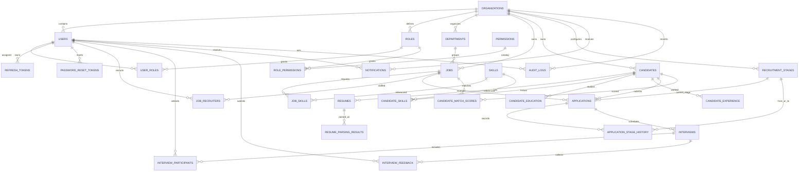

# Database design

Phase 2 defines the PostgreSQL schema for tenant-owned recruitment data; Phase 3 adds a one-time password-reset token table. EF Core 10 migrations live under `backend/src/HireFlow.Infrastructure/Persistence/Migrations`.

## Entity relationship diagram



`AI_PROCESSING_JOBS` and `AI_USAGE_LOGS` are organization-owned operational records. They intentionally do not contain direct foreign keys to arbitrary business entities; the job payload stores validated identifiers and the service resolves those through tenant-scoped application queries.

## Tables

| Area | Tables |
|---|---|
| Organization and access | `organizations`, `users`, `roles`, `user_roles`, `permissions`, `role_permissions`, `departments`, `refresh_tokens`, `password_reset_tokens` |
| Jobs | `jobs`, `skills`, `job_skills`, `job_recruiters` |
| Candidates | `candidates`, `resumes`, `candidate_skills`, `candidate_education`, `candidate_experience` |
| Recruitment | `applications`, `recruitment_stages`, `application_stage_history`, `interviews`, `interview_participants`, `interview_feedback` |
| AI | `resume_parsing_results`, `candidate_match_scores`, `ai_processing_jobs`, `ai_usage_logs` |
| Operations | `notifications`, `audit_logs` |

`skills` and `permissions` are global catalogs; join and membership rows remain tenant-owned. All other organization-owned rows include `OrganizationId`. Organization, tenant-owned, and auditable records carry UTC creation/update timestamps; creator IDs are recorded where applicable. Resume rows store a private storage key and metadata only; no resume bytes are stored in PostgreSQL.

## Tenant integrity and indexing

Every tenant entity has a UUID primary key and a unique `(OrganizationId, Id)` alternate key. Relationships between tenant-owned rows use composite foreign keys containing `OrganizationId`, so the database rejects a reference from one organization to another. Tenant lookup, workflow, and uniqueness indexes start with `OrganizationId`; email, slug, skill names, duplicate resume hashes, assignments, and application/job pairs have unique constraints.

These relational constraints protect writes, but they do not automatically filter reads. Authenticated organization resolution and query-level tenant enforcement are Phase 3 work. Do not expose this schema through unrestricted queries.

## Time and structured fields

Timestamps use .NET `DateTimeOffset` and PostgreSQL `timestamp with time zone`; application defaults are UTC. AI parse results, match explanations, processing payloads, notification data, and audit metadata use PostgreSQL `jsonb`. Resume file contents remain in private object storage.

## Migration commands

The local EF tool is pinned in `dotnet-tools.json`:

```powershell
# From the repository root
$env:ConnectionStrings__DefaultConnection = "Host=localhost;Port=5432;Database=hireflow;Username=hireflow;Password=local_dev_only"
dotnet tool restore
dotnet tool run dotnet-ef database update --project backend/src/HireFlow.Infrastructure --startup-project backend/src/HireFlow.API
```

Development API startup applies pending migrations automatically. Production deployments should apply reviewed migrations as a deployment step rather than rely on application startup.


